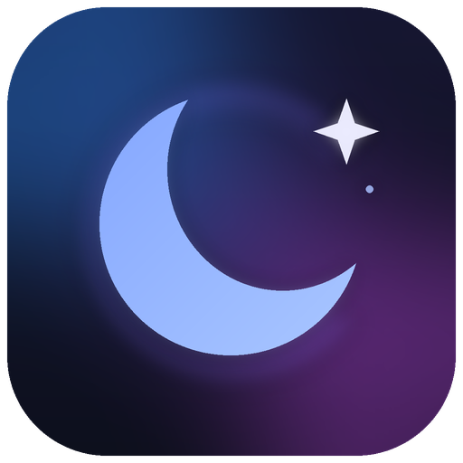
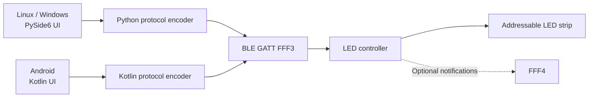

<div align="center">
  

  # LUNA Light Studio

  **A cross-platform Bluetooth LED controller built from a reverse-engineered BLE protocol.**

  Linux · Windows · Android

  Control colour, brightness, power, animations and more — with a colour-reactive interface and persistent personal palettes.
</div>

---

## Overview

LUNA is an independent application for a Bluetooth LED strip advertised as **`GATT--DEMO`**. It started as a Python experiment to control a strip from a PC and evolved into a desktop application for Linux and Windows plus a native Kotlin Android port.

The original controller application was limited to Android. LUNA adds a desktop interface, reusable colour presets, an adaptive dark theme, and a common set of documented Bluetooth commands across platforms. **Core LED control has been exercised on Linux, Windows and Android with the project's original controller.** Compatibility with other controllers has not been established.

> [!IMPORTANT]
> LUNA is an independent interoperability project, not affiliated with or endorsed by the original controller/app vendor. It targets a specific family of BLE controllers, not arbitrary Bluetooth lighting products.

## Features

| Feature | Linux | Windows | Android |
|---|:---:|:---:|:---:|
| BLE connection and power toggle | ✓ | ✓ | ✓ |
| Global colour, brightness, HEX selection | ✓ | ✓ | ✓ |
| Colour wheel / colour picker | ✓ | ✓ | ✓ |
| Named, persistent saved colours | ✓ | ✓ | ✓ |
| Colour-reactive dark theme | ✓ | ✓ | ✓ |
| 58 built-in effect selections, speed and direction | ✓ | ✓ | ✓ |
| Pixel count and RGB channel order | ✓ | ✓ | ✓ |
| Controller microphone modes | ✓ | ✓ | ✓ |
| Local music playback | ✓ | ✓ | — |
| PC audio-reactive colour updates | ✓ | ✓ | — |
| Controller-side schedules | Experimental | Experimental | Experimental |
| Arbitrary per-LED / per-segment colours | — | — | — |

A check mark indicates an implemented control, **not universal firmware compatibility or individual hardware verification of every effect**. See [feature status](docs/FEATURE_MATRIX.md) for details.

## Quick start

### Linux (CachyOS / Arch / KDE)

```bash
sudo pacman -S --needed python python-pip bluez portaudio
sudo systemctl enable --now bluetooth
cd desktop
./install-luna.sh
```

Find **LUNA Light Studio** in the KDE application launcher, or run `~/.local/bin/luna`. The installer builds a bundled executable locally; no virtual environment is needed for everyday use.

### Windows 10/11

Install Python 3.11+ for the **one-time build**, then open `desktop/` and double-click **`install-windows.bat`**. The installer builds `LUNA.exe` locally and adds a Start menu shortcut. Subsequent launches do not require Python.

### Android

Use Android Studio or the CLI with **JDK 17**, **Android SDK Platform 35** and **Gradle 8.7**:

```bash
cd android
./setup-wrapper.sh  # requires Gradle installed; only needed once
./gradlew assembleDebug
adb install -r app/build/outputs/apk/debug/app-debug.apk
```

See the [full build guide](docs/BUILDING.md) for prerequisites, troubleshooting and device permissions.

## Project structure

```text
LUNA-Light-Studio/
├── desktop/            # Shared PySide6 + Bleak app for Linux and Windows
│   ├── mrstar/          # Protocol, BLE transport, GUI, theme, audio, effects
│   ├── tests/           # Protocol, mocked BLE, theme and palette tests
│   ├── install-luna.sh  # Linux builder / KDE installer
│   └── install-windows.bat
├── android/            # Native Kotlin app, custom colour wheel, Android BLE
├── docs/               # Architecture, protocol research and project write-up
├── tools/              # Read-only BLE discovery utility
└── .github/workflows/  # Automated checks
```

The Python package retains its original internal name `mrstar` for compatibility with existing imports; **the product is LUNA**. Linux and Windows use the **same** desktop source, rather than two diverging copies.

## How it works



LUNA discovers the controller by its advertised name `GATT--DEMO`, so the public source contains **no personal device address**. Desktop users may optionally set `LUNA_BLE_ADDRESS` to target a specific controller if name discovery fails. The Android app currently matches the advertised name.

The controller exposes service `FFF0`, write characteristic `FFF3`, and notification characteristic `FFF4`. Packets are encoded locally; the application does not use a cloud service for LED control. Details and example frames are in the [protocol documentation](docs/PROTOCOL.md).

## Development story

The project involved Android APK analysis, BLE GATT inspection, packet reconstruction, asynchronous write-queue debugging, UI design, native Android development, and cross-platform packaging. The full narrative, engineering decisions and lessons learned are documented in [the technical project write-up](docs/PROJECT_WRITEUP.md).

**A particularly important fix** was serialising BLE writes and sending a *single* power command per toggle. Earlier builds sometimes turned lights off immediately but delayed or failed to turn them on. The Android port uses a corresponding queued GATT-write approach.

## Limitations and safety

- **Custom segment colours are not supported** by the currently documented BLE protocol. Built-in rainbow effects show that the controller can generate multiple colours, but do not demonstrate arbitrary per-pixel writes.
- The active-pixel-count setting changes the number of LEDs driven; it is **not** a segment-addressing mechanism.
- Controller-side timers and some extended modes are experimental; verify them before relying on unattended operation.
- A successful BLE write means the transport accepted the packet; it does not prove the LED controller executed it.
- Do not connect multiple LUNA/Mr Star instances to the same controller simultaneously.

## Documentation

- [Building and installation](docs/BUILDING.md)
- [Architecture and data flow](docs/ARCHITECTURE.md)
- [BLE protocol reference](docs/PROTOCOL.md)
- [Feature matrix](docs/FEATURE_MATRIX.md)
- [Development journey](docs/DEVELOPMENT_HISTORY.md)
- [Technical project write-up](docs/PROJECT_WRITEUP.md)
- [Troubleshooting](docs/TROUBLESHOOTING.md)
- [Read-only GATT inspection tool](tools/README.md)
- [Publishing and releases](docs/PUBLISHING.md)
- [Contributing](CONTRIBUTING.md) · [Security and privacy](SECURITY.md)

## Testing

Run the desktop unit tests without physical BLE hardware:

```bash
cd desktop
python -m unittest discover -s tests -v
```

The suite covers packet encoding, write ordering, colour persistence, and adaptive-theme contrast. Platform-specific GUI/Bluetooth integration still requires real-device testing.

## Licensing and attribution

A project licence **has not yet been selected**. Please choose one before inviting reuse or contributions; see [licensing guidance](docs/LICENSING.md). This repository intentionally excludes the original proprietary APK, decompiled vendor source, device captures, and personal BLE addresses. Third-party dependencies retain their own licences.
