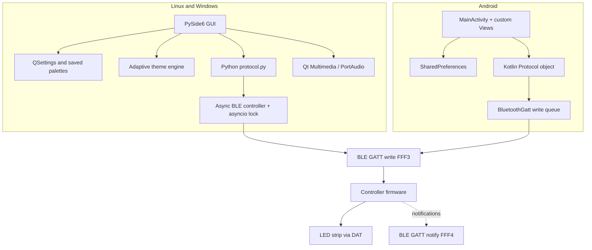

# Architecture

LUNA is a **two-client, one-protocol** project. Linux and Windows share a Python/PySide6 desktop client; Android is a native Kotlin client. Both encode the same family of BLE packets but use platform-specific Bluetooth APIs.

## Component diagram

## Desktop layers

| File | Responsibility |
|---|---|
| `desktop/main.py` | Qt application entry point, application identity and icon |
| `desktop/mrstar/window.py` | Main UI, navigation, control events, preference integration |
| `desktop/mrstar/ble.py` | Discovery, connection lifecycle, ordered writes, notifications |
| `desktop/mrstar/protocol.py` | Pure packet encoders and timer notification parsing |
| `desktop/mrstar/effects.py` | 58 effect names, categories and numeric IDs |
| `desktop/mrstar/palette.py` | Saved-colour validation and JSON serialisation |
| `desktop/mrstar/theme.py` | Colour-derived dark theme and contrast calculations |
| `desktop/mrstar/audio.py` | Desktop audio capture and reaction support |

The BLE controller's `asyncio.Lock` prevents simultaneous writes. The normal power toggle sends **one** frame. A multi-frame operation such as clock sync followed by timer configuration uses `send_many()` to keep the sequence together.

Desktop UI changes and Bluetooth commands are deliberately separate. Moving the colour picker can preview the interface theme without sending a BLE command until the user confirms the colour. On connection, saved colour, brightness, and pixel-count settings are **not** automatically pushed to the controller.

## Android layers

| File | Responsibility |
|---|---|
| `MainActivity.kt` | Touch UI, navigation and control actions |
| `ColourWheelView.kt` | HSV wheel, gesture ownership and touch-release callbacks |
| `GlowOrbView.kt` | Colour-preview visualisation |
| `PaletteStore.kt` | Named saved colours and preferences |
| `Protocol.kt` | Kotlin implementations of BLE packet encoders |
| `LedBluetooth.kt` | Scan, GATT connection, service discovery and serialised writes |
| `app/src/main/assets/effects.json` | Effect catalogue used by the UI |

Android's `BluetoothGatt` reports write completion via a callback. `LedBluetooth` holds a FIFO queue and sends the next packet only after the preceding write callback. The colour wheel uses `requestDisallowInterceptTouchEvent(true)` while dragging so the surrounding `ScrollView` cannot steal the gesture.

## State and persistence

- **Linux/Windows:** Qt `QSettings`, application `LUNA`, organisation `LUNA Light Studio`.
- **Android:** `SharedPreferences` named `luna`.
- **Named palettes:** `saved_colours_v1`, a JSON array of `{ "name": "...", "hex": "#RRGGBB" }` objects. The data format is compatible in concept, but **automatic cross-device synchronisation is not implemented**.
- **Power state:** LUNA's local toggle is not a hardware-confirmed state readback.

## Hardware boundary

The original BLE controller exposes service `FFF0`, command-write characteristic `FFF3` and notification characteristic `FFF4`. The firmware translates commands into the LED strip's physical data stream. The project has not measured that signal or identified a proven direct per-pixel write command. The physical controller is therefore a hard boundary for custom segment features.

## Portability decisions

The two desktop platforms intentionally share source code and tests; platform-specific packaging lives alongside it. Android has its own implementation because Qt desktop widgets and Bleak's Python backend are not directly portable to a native Android UI. Both implementations should be updated together when a protocol change is made.
